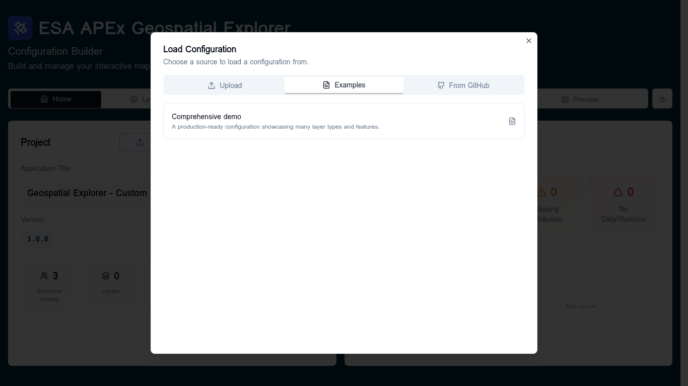

# Loading and saving

The Configuration Builder keeps a local copy of your working configuration in
this browser and opens it again when you come back. Nothing is saved to a
server. Exporting still downloads the JSON file you ship, and exporting does
not remove the local copy.

## Starting over

**New** on the Home tab resets the builder. **Discard saved session** deletes
the local copy without changing what is on screen. The unsaved-changes guard
still asks before **New** or loading a different file replaces unexported edits.

If the same configuration is edited in two tabs, the older tab stops saving
and asks you to load the other tab's version or keep this one. If the browser
refuses to store the copy, one message asks you to export, and closing the
tab warns you while there are unexported edits.

## Loading a config

From the **Home** tab click **Load** to open the **Load Configuration**
dialog.

Three sources are available:

| Source       | When to use it |
|--------------|----------------|
| **Upload**   | A `config.json` you already have on disk. |
| **Examples** | Start from the bundled **Comprehensive demo** — useful for learning the app or as a template. |
| **From GitHub** | Browse a configured GitHub repo (default: `ESA-APEx/apex_geospatial_explorer_configs`) and pick any `config.json` from any branch. |

While loading, the dialog shows a four-stage progress bar: **Parsing JSON →
Normalizing structure → Validating schema → Done**. If the schema validation
fails, the dialog hands the offending file to a recovery dialog where you can
fix or remove invalid entries.

## The unsaved-changes guard

Anything that would discard the current config (loading a different one,
clicking **New**, navigating away) prompts you with an **Unsaved Changes**
warning when there are recent unexported edits. Confirm to continue or
cancel and export first.

## Exporting

From the **Home** tab use the **Export** dropdown:

- **Quick Export (Default)** — downloads the current config as JSON immediately.
- **Export with Options…** — opens the [Export options](../configuration/export-options.md)
  dialog, where you can choose JSON ordering and other formatting options.

### Filename convention

Exported files follow the pattern `<prefix>_YYYYMMDD_HHMM.json` — for
example `config_biodiversity_20251114_1530.json`. The timestamp is added
automatically so successive exports never overwrite each other.

The `<prefix>` portion is taken from the **Export filename prefix** field in
[Settings → Config Export Settings](../settings/overview.md#config-export-settings).
Change it there to match your project naming convention.

The exported file is what you ship to the APEx Geospatial Explorer host.

## Starting fresh

Click **New** on the **Home** tab to reset the builder to an empty
configuration. The unsaved-changes guard applies here too.
