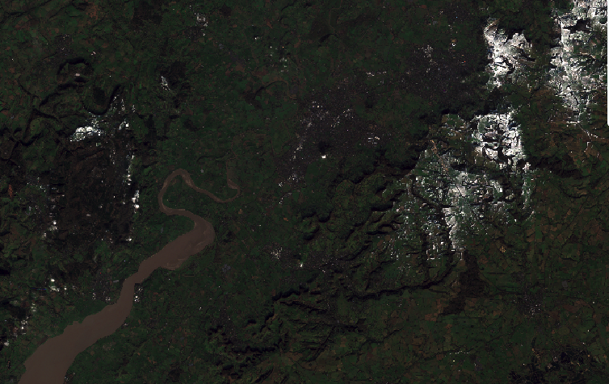
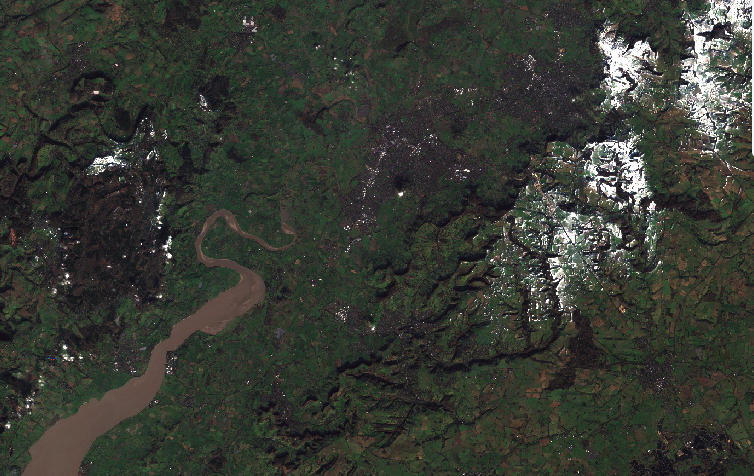

# 9-3. Styling multi-spectral data as natural colour

In this exercise we will work with an existing configuration. If you are following on from previous exercises you may want to **export your current config**, as we will load up a new one.

1.  From the configuration builder **Home** page, select **Load -> Tutorials -> Tutorial 9 pre-requisites**.

    !!! info "About this config"
        This config file has a few multi-spectral datasets already included. Some of these are from the [**UK Earth Observation Data Hub**](https://eodatahub.org.uk/) so we have also added in support in this config for **British National Grid** as a custom Coordinate Reference System. Custom CRS definitions are covered in Tutorial 11 if you wish to replicate this elsewhere.

2. Take a look at the **Bristol Sentinel 2 scene** layer in the Sentinel 2 interface group. Right now this is just a normal layer, with a COG added, as you have done before.

    - Note how the row in the _Datasets_ tab tells us it has 10 bands, but they are "undefined".
    - Now click on the **( i )** icon on that row to inspect the COG metadata. Note how it has a dropdown of bands and you can inspect the statistics of each individually.

    { width="100%" }

3.  Now let's add some styling. On the main layer card select the **Pen** icon next to the **multi-band visualisations** option. This will open a popup with two tabs, one called **Composites** and another called **Indices**. Take a brief look at what is in each.

    { width="100%" }

    !!! info "Composites vs indices. What's the difference?"
        **Composites** take three bands and visualise them in the _red_, _green_ and _blue_ channels of the output. If the input bands are also red, green and blue wavelengths, then this will look like a natural colour image. However, if they are other wavelengths then they will reveal patterns not visible to the naked eye.

        **Indices**, meanwhile, make per-pixel calculations across multiple bands, ending up with a value typically between -1 and +1. These indices reveal interesting insights according to the formula used!

4.  Select **Composites -> Natural colour**. You will see down the left that some _bands_ have already been selected for you. You will also see some _histograms_. We will go with these defaults for now. Save the visualisation, and then go to **Preview** to take a look at the layer so far, zooming in to take a look in more detail.

    !!! info "You might think the image looks a bit dark?"
        The natural colour visualisation you selected by default stretches the red, green and blue channels between _2 and 98%_ - i.e. ignoring 2% of pixels that are either really dark or really bright, to remove some outliers. However, you will have noticed that this scene, which is from January, includes areas of white - snow on the hills. This therefore means that a lot of bright pixels are influencing the stretch on the scene.

    

5.  Return to the layer card, and **edit the visualisation** again (via the pen icon next to multi-band visualisation)! This time, apply the **Mean +- σ** stretch (where σ is _standard deviation_). Click save, then **Preview** and see how this has impacted the colour balance of the image.

    

### Did you remember to export?
