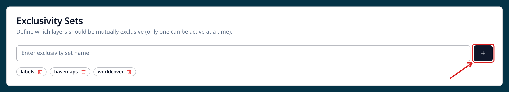

# 9-4. Other composite styles

## Optional: create an exclusivity set

We are going to be copying the Bristol Sentinel 2 layer a few times now as we work with different visualisations. We can create a set of layers as _"mutually exclusive"_, so that switching one on turns the other one off. This is not essential, but useful for this and future exercises.

1. On the **layers** tab of the UI, scroll to the bottom beneath all your layers and base layers until you get to **Exclusivity sets**. Type **bristol-s2** into the text entry box then select **+ Add**.

    { width="420" }

2. On the **top row** of the _Bristol Sentinel 2_ layer card, select the **pencil icon** on the right to _Edit_ the layer definition. Scroll to the very bottom and tick the check box next to the **bristol-s2** set you just added.

## Duplicate the layer and create a new visualisation method

1. On the **top row** of the _Bristol Sentinel 2_ layer card, select the **duplicate layer** icon - two overlapping blue squares, with a tooltip.

    { width="100%" }

2. On the **Bristol Sentinel 2 (copy)** layer, click the **red trash can** icon next to the RGB visualisations to clear the current settings, then click the **pencil** icon to set a new visualisation. Choose one of interest - the **Composite options** table below explains each one.

3. Now **edit the layer names** - change _Bristol Sentinel 2_ to _Bristol Sentinel 2 natural colour_ and _Bristol Sentinel 2 (copy)_ to something meaningful.

4. Open the **Preview**. Admire your work.

5. **Tweak** your visualisation stretches. If you want, repeat the last few steps for different visualisation options.

## Composite options

Each option asks a different question of the same scene. The bands are picked for you from the bands your dataset actually has.

| Option | Bands used | What to look for around Bristol |
| --- | --- | --- |
| **Natural colour** | Red, Green, Blue | The scene as your eye would see it — the baseline for comparing everything else. |
| **False colour infrared** | NIR, Red, Green | Healthy vegetation shows bright red, so **Leigh Woods** and the farmland to the south-east stand out against grey urban areas. |
| **Agriculture** | SWIR1, NIR, Blue | Separates crops, bare soil and water — fields east of the city take on different hues depending on what is growing. |
| **Urban / geology** | SWIR2, SWIR1, Red | Built-up areas come to the fore: the city centre, **Avonmouth** docks and the industrial estates along the river. |
| **Custom** | Any three you pick | Build a combination of your own — swap the blue band for a shortwave infrared band and see what changes. |

!!! info "Different data, different bands"
    The exact bands behind each option depend on the file you are looking at. A 10-band Sentinel-2 stack and a 3-band RGB image cannot offer the same views, so an option may be missing or resolve to different bands elsewhere.

### Did you remember to export?
