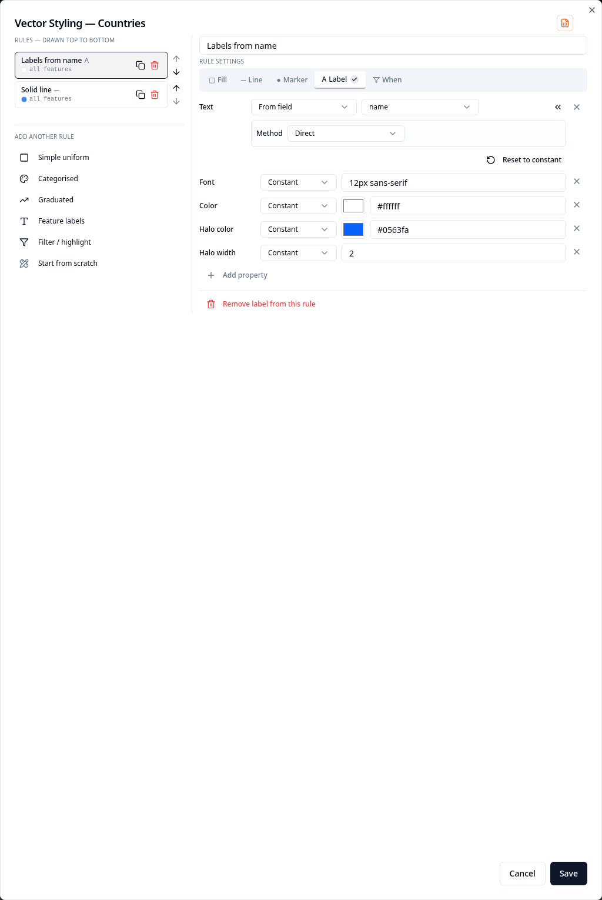
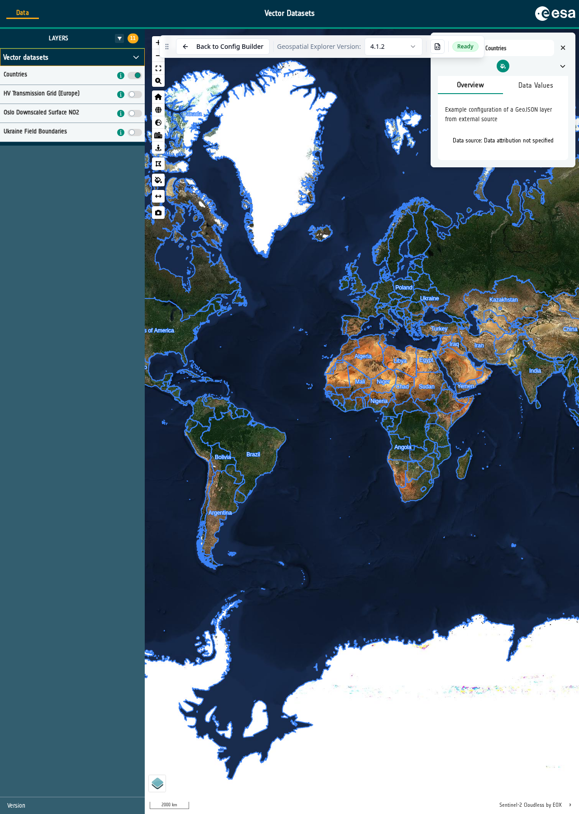
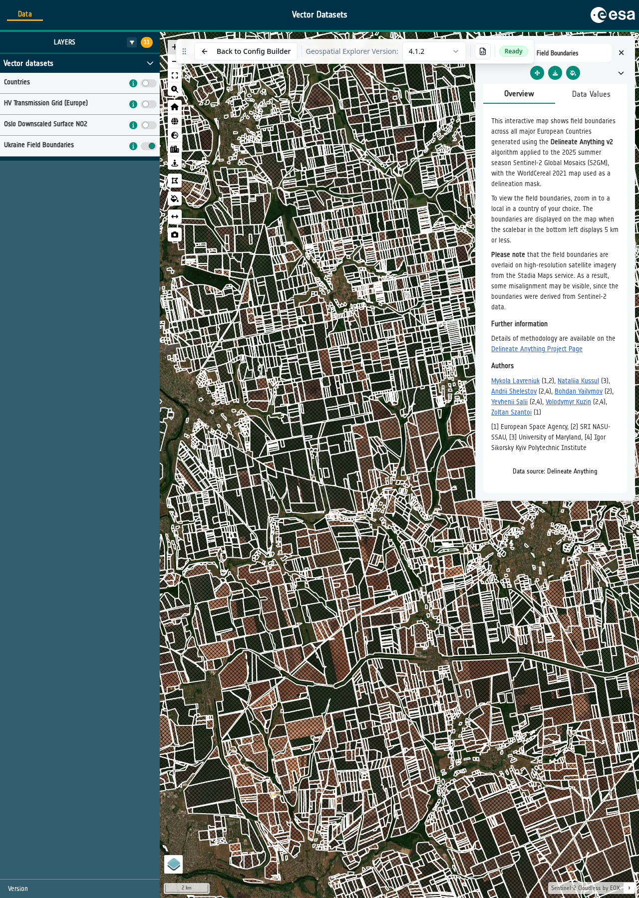

# 10-3. Simple styling

Simple styling gives every feature the same appearance. We will first outline
and label the countries, then use a cross-hatched fill for a much larger field
boundary dataset.

## Outline and label the countries

1. Open the **Countries** layer card. Under **Data Visualisation**, select the
   **Pen** next to **Vector Styling**.

2. The starting file contains example rules. Remove both existing rules with
   their red bin buttons so that the recipe gallery appears, then select
   **Simple uniform**.

3. Keep **Symbolise as** set to **Polygons — fill + outline**, choose the colours
   you want, keep **Fill style** as **Solid**, and select **Create rule**.

4. In the rule editor select the **Fill** tab, then select **Remove fill from
   this rule**. This leaves a simple outline. Under **Add another rule**, select
   **Feature labels**, choose the `name` field, and select **Create rule**.

   { width="100%" }

5. Select **Save**, then open **Preview** and turn on **Countries**. Check that
   each country has an outline and a name.

   { width="100%" }

## Cross-hatch the field boundaries

6. Return to the Configuration Builder and open **Ukraine Field Boundaries**.
   Select the **Pen** next to **Vector Styling**, then select **Simple uniform**.

7. Keep **Symbolise as** set to **Polygons — fill + outline**. Set **Fill style**
   to **Cross hatch**, choose contrasting fill and outline colours, then select
   **Create rule** and **Save**.

   { width="100%" }

8. Open **Preview**, navigate to Ukraine, turn on **Ukraine Field Boundaries**
   and zoom in until the individual fields appear.

   { width="100%" }

!!! info "Why do the fields only appear when you zoom in?"
    The dataset has a `minZoom` value of `10` in the underlying configuration
    JSON. It contains hundreds of thousands of field polygons. Drawing all of
    them across Ukraine at a scale where they would not be legible would add a
    great deal of unnecessary rendering work, so the Explorer waits until the
    map is sufficiently zoomed in.

### Did you remember to export?
