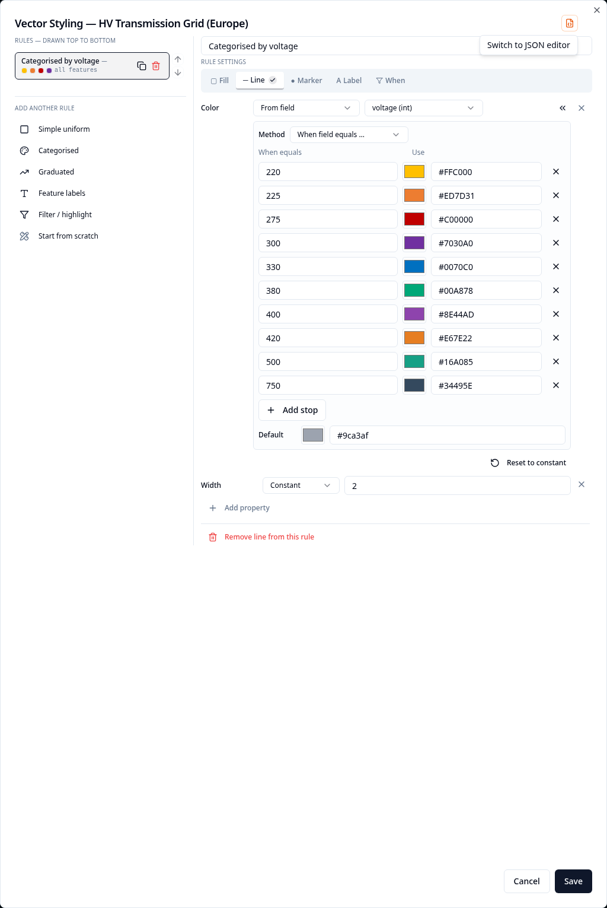
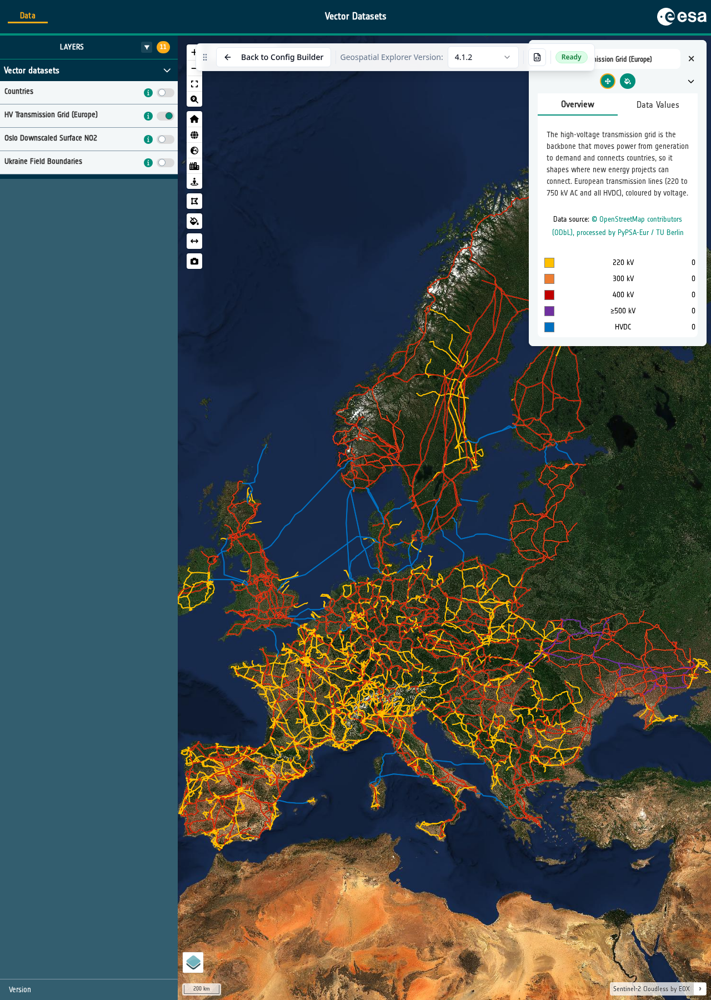

# 10-4. Categorised styling

Categorised styling assigns a colour to each distinct value of an attribute.
It works best when the attribute has a manageable number of repeated values.

1. Open the **HV Transmission Grid (Europe)** layer card. Under **Data
   Visualisation**, select the **Pen** next to **Vector Styling**.

2. In the recipe gallery, select **Categorised**.

3. The grid is line data, so check that **Symbolise as** is **Lines — stroke**.
   Select the `voltage` field. The recipe reads the source data and lists the
   detected voltage values as categories.

4. Choose a palette. You can select **Reverse** if you prefer its colours in the
   opposite order, then select **Create rule** and **Save**.

   { width="100%" }

5. Open **Preview**, turn on **HV Transmission Grid (Europe)** and zoom into an
   area of the network. The line colours now distinguish the voltage values.

   { width="100%" }

!!! note
    `voltage` is stored as a number, but here we are treating each detected
    voltage as a distinct category. The next exercise uses numeric values as a
    continuous range instead.

### Did you remember to export?