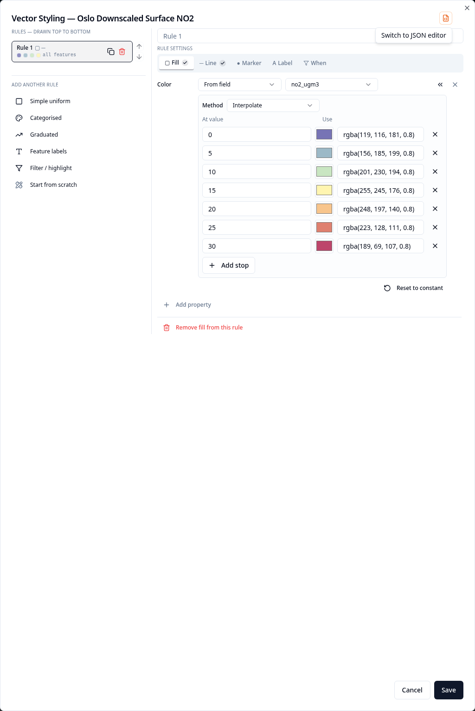
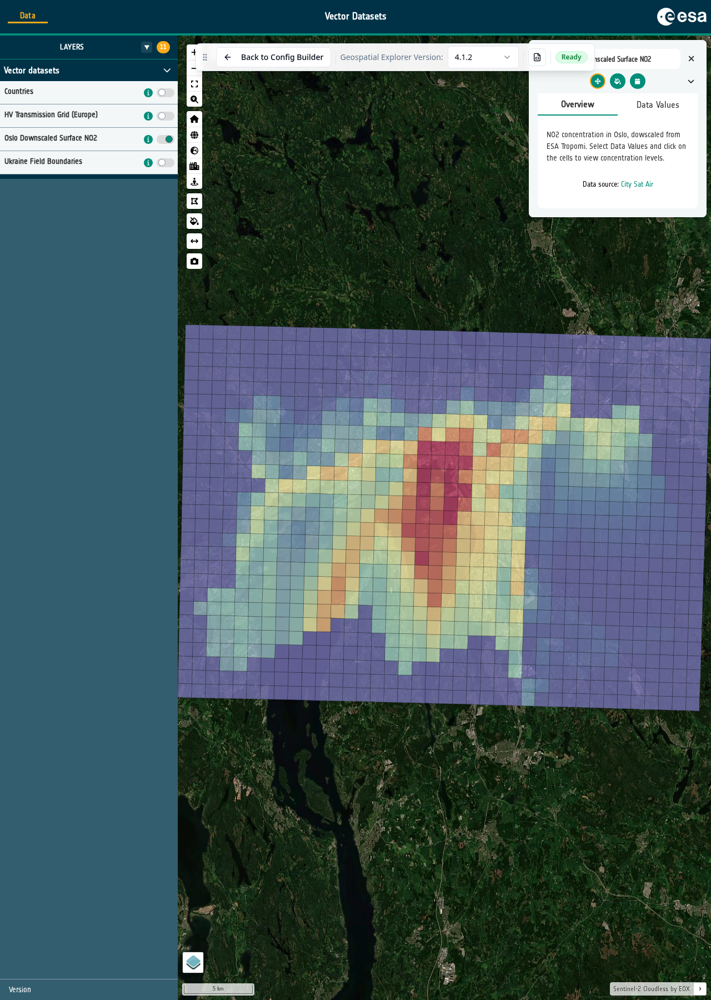

# 10-5. Graduated styling

Graduated styling divides numeric values into classes and colours them along a
ramp. This makes lower and higher values easy to compare without requiring a
separate colour for every exact measurement.

1. Open the **Oslo Downscaled Surface NO2** layer card. Under **Data
   Visualisation**, select the **Pen** next to **Vector Styling**.

2. Remove the existing rule, then select the **Graduated** recipe.

3. Keep **Symbolise as** set to **Polygons — fill + outline** and select the
   `no2_ugm3` field. This is the estimated nitrogen dioxide concentration in
   micrograms per cubic metre.

4. Keep the detected range and **Equal interval** classes. Choose a sequential
   colour ramp in which the progression from low to high values is clear, then
   select **Create rule** and **Save**.

   { width="100%" }

5. Open **Preview**, turn on **Oslo Downscaled Surface NO2** and zoom to Oslo.
   Compare areas with lower and higher concentrations. Use the temporal control
   to move between dates and see how the pattern changes.

   { width="100%" }

The layer contains many dated GeoJSON datasets. The vector style is applied to
all of them, so the same colours and class boundaries remain meaningful while
you move through the time series.

### Did you remember to export?