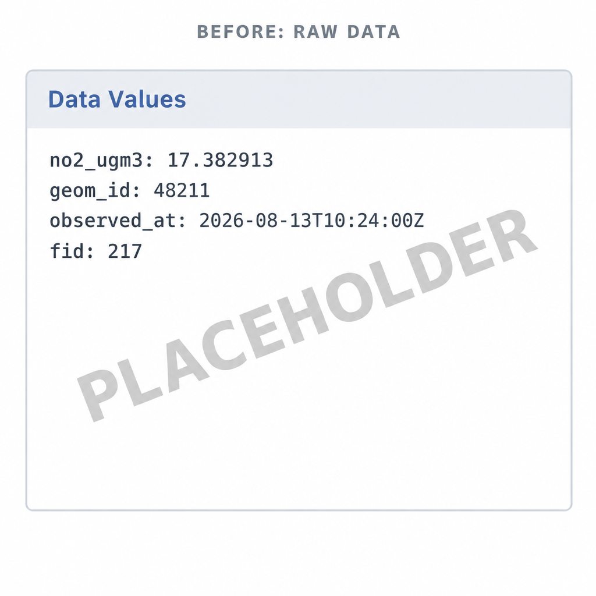

# 10-6. Customising vector field values

When someone clicks a vector feature in the Geospatial Explorer, the **Data
Values** panel lists that feature's properties. Unless you tell the Explorer
otherwise, it shows the data exactly as it is stored. In this exercise you will
turn the raw properties of the Oslo nitrogen dioxide data into a short, readable
summary.

## Look at the raw values first

1. Open **Preview**, turn on **Oslo Downscaled Surface NO2** and zoom to Oslo.

2. Open **Data Values** and click one of the grid cells.

   { width="100%" }

   Notice that:

   - the labels are raw property names such as `no2_ugm3` and
     `uncertainty_ugm3`;
   - numbers are shown at full precision, with no units;
   - housekeeping fields such as `city`, `product`, `datetime_utc`,
     `source_datetime` and `obs_index` are listed even though they don't help
     the reader.

## Customise the fields

3. Return to the configuration and open the **Oslo Downscaled Surface NO2**
   layer card. Open the **Manage Fields** editor.

4. Select **Populate field details**. The editor reads the property names from
   the layer's data and adds one row per field. The layer contains many dated
   GeoJSON files, but they all share the same fields, so the settings you make
   here apply to every date.

5. Enter a **Display label** for the three fields readers need:

    | Field name | Display label |
    |---|---|
    | `date` | `Observation date` |
    | `no2_ugm3` | `Nitrogen Dioxide` |
    | `uncertainty_ugm3` | `Uncertainty` |

6. For both `no2_ugm3` and `uncertainty_ugm3`, set the **Suffix** to
   `ug / m3` and the **Precision** to `2`. Values such as `17.382913` will
   now be shown as `17.38 ug / m3`.

7. Turn on **Hide** for `city`, `product`, `datetime_utc`, `source_datetime`
   and `obs_index`.

    !!! info "Hidden fields are kept"
        Hidden rows stay in the editor, greyed out. In the configuration they
        are stored as `null`, so you can unhide them later without losing
        anything.

8. Use the up/down arrows or the drag handle to put the visible rows in this
   order: **Observation date**, **Nitrogen Dioxide**, **Uncertainty**. This
   order is the order in which the fields appear in the Data Values panel.

9. Select **Save**.

## Check the result

10. Open **Preview** again, turn on the Oslo layer if needed and click the same
    cell. The Data Values panel now shows three clearly labelled values with
    units and two decimal places. The housekeeping fields are no longer listed.

11. Optionally, open the JSON editor and find the Oslo layer's `meta.fields`.
    It should be equivalent to:

    ```json
    "fields": {
      "date": { "label": "Observation date" },
      "no2_ugm3": { "label": "Nitrogen Dioxide", "suffix": "ug / m3", "precision": 2 },
      "uncertainty_ugm3": { "label": "Uncertainty", "suffix": "ug / m3", "precision": 2 },
      "city": null,
      "product": null,
      "datetime_utc": null,
      "source_datetime": null,
      "obs_index": null
    }
    ```

    Your file may also include an `order` value on each visible field. This
    records the row order you set in step 8.

For the full list of field options, including date formatting and URL fields,
see [Data Values (vector)](../../layers/data-values-vector.md).

### Did you remember to export?
