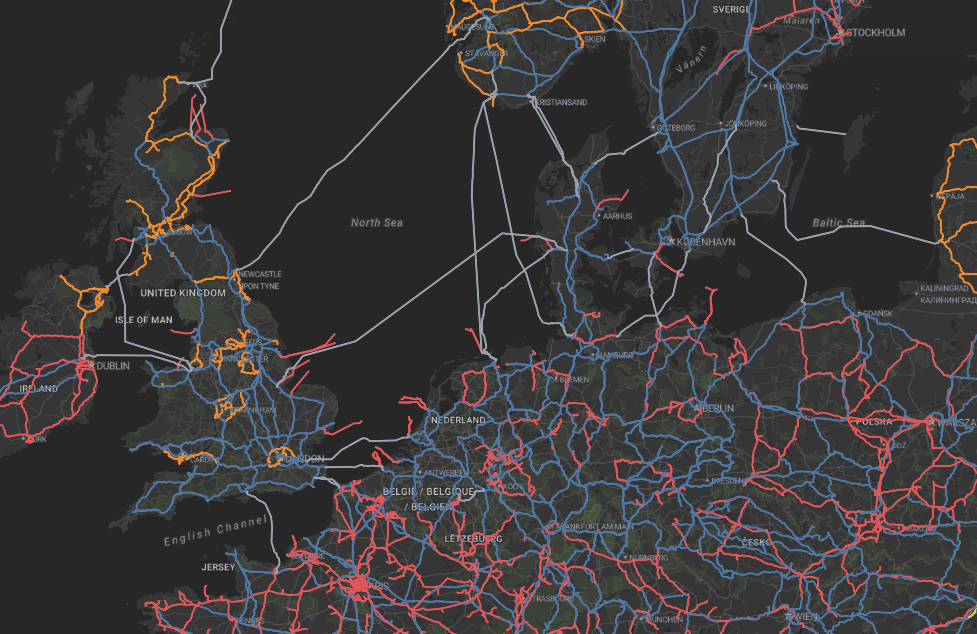

# 10. Vector data

## Tutorial Objectives

Vector data can add useful context to Earth Observation imagery and can also be
an output from Earth Observation projects. In this tutorial you will use four
prepared vector layers to explore the main styling approaches available in the
Geospatial Explorer.

By the end of this tutorial you will be able to:

- Understand where vector data complements Earth Observation imagery.
- Recognise when GeoJSON or FlatGeoBuf is appropriate.
- Create outlined and labelled polygon styles.
- Use a cross-hatched fill for a dense polygon dataset.
- Colour distinct attribute values with categorised styling.
- Show variation in numeric data with graduated styling.
- Make feature values readable with labels, units, rounding and hidden fields.

## Steps

- [10-1. Pre-requisites](01-prerequisites.md)
- [10-2. Key concepts](02-key-concepts.md)
- [10-3. Simple styling](03-styling-your-data.md)
- [10-4. Categorised styling](04-categorised-styling.md)
- [10-5. Graduated styling](05-graduated-styling.md)
- [10-6. Customising vector field values](06-customising-field-values.md)
