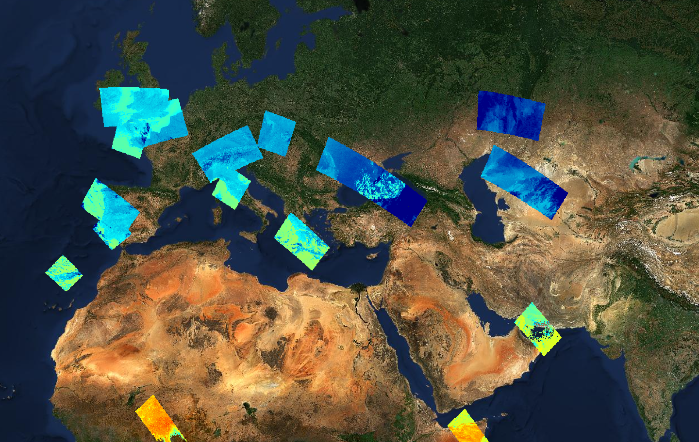

# 12. STAC as a data source

## Tutorial Objectives

Many Earth Observation projects publish their results through a STAC
(SpatioTemporal Asset Catalog) catalogue. As well as browsing a STAC catalogue
to discover data, the Geospatial Explorer can use a STAC collection, item or
query directly as a data source. In this tutorial you will load a prepared
configuration of STAC layers and inspect how they are defined and how they
behave.

By the end of this tutorial you will be able to:

- Explain what STAC is and how catalogues, collections, items and assets relate.
- Describe the difference between STAC as a discovery service and STAC as a data source.
- Recognise a STAC data source on a layer card.
- Inspect STAC collection, item, asset and queryable metadata.
- Understand how area, date and property filters become part of a STAC query.
- Describe how STAC layers behave in the preview, including time series.

## Steps

- [12-1. Pre-requisites](01-prerequisites.md)
- [12-2. Key concepts](02-key-concepts.md)
- [12-3. Inspecting STAC data sources](03-inspecting-stac-data-sources.md)
- [12-4. STAC in the preview](04-stac-in-the-preview.md)
